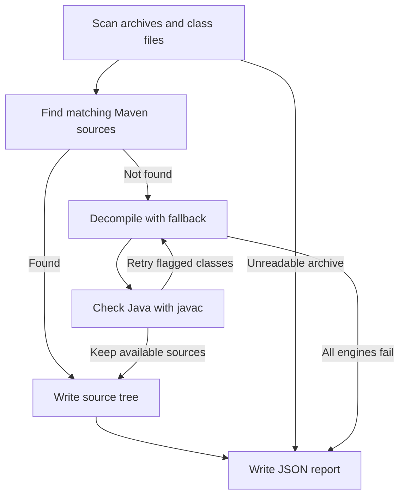
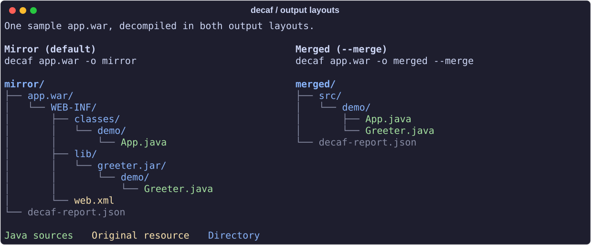

# decaf

Turn Java archives and loose `.class` files into source trees.

- **Published sources first.** Recover original sources from Maven when they
  match your binaries, with cached lookups for later runs.
- **Five decompilers with automatic fallback.** Retry crashes, timeouts,
  missing classes, and stubbed methods with the next engine.
- **Compile checks.** Check decompiled Java with `javac` and retry classes
  with decompiler errors. Keep unresolved diagnostics in the report.
- **Batch processing.** Scan folders of JAR, WAR, EAR, and AAR files,
  including nested dependencies.
- **Two output layouts.** Preserve the archive tree and its resources, or
  merge sources into one package tree.
- **Reports you can act on.** Inspect failed and partial artifacts,
  compiler diagnostics, and engine memory use after the run.


The demo includes an unreadable archive and a class that triggers a compile-check
retry. The valid archives still produce sources. [Demo inputs and recording](docs/development.md#readme-media).

## Quick start

Requires Python 3.11+, [uv](https://docs.astral.sh/uv/), and Java 17+ for
the default engine. Use a JDK to enable compile checks.

```bash
uv tool install git+https://github.com/vcth4nh/decaf
decaf ./libs
```

Sources and `decaf-report.json` go into `./decaf-out`.

```bash
decaf app.war -o out --merge       # one source tree under out/src
decaf report out --problems       # failed and partial artifacts
decaf self-update                 # install the latest release
```

See [installation and updates](docs/installation.md) for platform requirements
and other install methods, or [usage](docs/usage.md) for more commands.

## How it works



Maven sources skip decompilation and compile checks. Unresolved problems stay
in the [report](docs/reports.md); [compile checks](docs/compile-check.md) explain
which diagnostics trigger retries.

## Output layouts

- **Mirror:** keep archive paths, nested dependencies, and original resources.
- **Merged:** collect Java and Kotlin sources by package, with duplicate
  conflicts recorded in the report.



See [output layouts](docs/output-layouts.md) for resource handling and collisions.

## Documentation

| Guide | Covers |
| --- | --- |
| [Usage](docs/usage.md) | Commands, nested archives, engine options, case-sensitive output |
| [Reports](docs/reports.md) | Failures, partial results, exit codes, JSON and NDJSON |
| [Compile checks](docs/compile-check.md) | Retries, diagnostics, dependencies, limits |
| [Sources and engines](docs/sources-and-engines.md) | Maven matching, caches, engine versions and management |
| [Resource limits](docs/resource-limits.md) | CPU budgets, parallel jobs, heap budgets and memory reports |
| [Configuration](docs/configuration.md) | Config paths, Maven repositories, authentication |
| [Development](docs/development.md) | Tests and regenerating the demo and images |

## Agent skill

Install the included [Agent Skill](skills/decaf/SKILL.md) for Claude Code,
Codex, and other coding agents with the [skills CLI](https://github.com/vercel-labs/skills):

```bash
npx skills add vcth4nh/decaf
```

## Credits

decaf is inspired by [@rskvp93](https://github.com/rskvp93)'s srctools.
