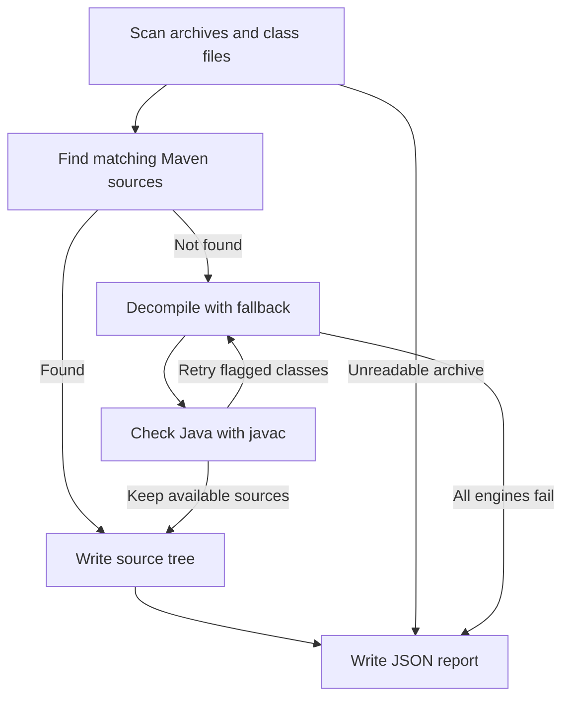

# decaf

Turn Java archives and loose `.class` files into source trees.

Recover matching Maven sources, or decompile with automatic fallback and
compile checks.

## Quick start

Requires Python 3.11+, [uv](https://docs.astral.sh/uv/), and Java 17+ for
the default engine. Use a JDK to enable compile checks.

```bash
uv tool install git+https://github.com/vcth4nh/decaf
decaf ./libs
```

Sources and `decaf-report.json` go into `./decaf-out`.

```bash
decaf app.war -o out --merge       # one source tree under out/src
decaf report out --problems       # failed and partial artifacts
decaf self-update                 # install the latest release
```

See [installation and updates](docs/installation.md) for platform requirements
and other install methods, or [usage](docs/usage.md) for more commands.

## Features

### Sources, compile checks, and fallback

Recover original sources from Maven when they match your binaries, with sources
and lookup results cached for later runs. Otherwise, a chain of five decompilers
retries crashes, timeouts, missing classes, and stubbed methods. Checks with
`javac` also retry classes with decompiler errors.

One `demo.jar` contains the SLF4J logging library and a small application class.
The demo downloads the library's published sources, decompiles the application,
and fixes a compile-check error by retrying with CFR.


[Download the demo JAR](docs/demos/demo.jar). See
[sources and engines](docs/sources-and-engines.md) for Maven matching and caching,
or [compile checks](docs/compile-check.md) for retry rules and limitations.

### Batch processing and output layouts

Scan folders of JAR, WAR, EAR, and AAR files, including nested dependencies.
Mirror output preserves archive paths and resources; `--merge` collects sources
into one package tree. Both layouts below come from the same WAR and its nested JAR.


See [output layouts](docs/output-layouts.md) for resource handling and collisions.

### Failures and reports

A broken archive does not stop valid archives from producing sources. Inspect
failed and partial artifacts, compiler diagnostics, and engine memory use after
the run. The demo shows an unreadable archive alongside complete and partial
results, then opens the problem summary and artifact details.


See [reports](docs/reports.md) for exit codes and JSON output, or
[demo inputs and recording](docs/development.md#readme-media) to reproduce these GIFs.

## How it works



Maven sources skip decompilation and compile checks. Unresolved problems stay
in the [report](docs/reports.md); [compile checks](docs/compile-check.md) explain
which diagnostics trigger retries.

## Documentation

| Guide | Covers |
| --- | --- |
| [Usage](docs/usage.md) | Commands, nested archives, engine options, case-sensitive output |
| [Reports](docs/reports.md) | Failures, partial results, exit codes, JSON and NDJSON |
| [Compile checks](docs/compile-check.md) | Retries, diagnostics, dependencies, limits |
| [Sources and engines](docs/sources-and-engines.md) | Maven matching, caches, engine versions and management |
| [Resource limits](docs/resource-limits.md) | CPU budgets, parallel jobs, heap budgets and memory reports |
| [Configuration](docs/configuration.md) | Config paths, Maven repositories, authentication |
| [Development](docs/development.md) | Tests and regenerating demos and images |

## Agent skill

Install the included [Agent Skill](skills/decaf/SKILL.md) for Claude Code,
Codex, and other coding agents with the [skills CLI](https://github.com/vercel-labs/skills):

```bash
npx skills add vcth4nh/decaf
```

## Credits

decaf is inspired by [@rskvp93](https://github.com/rskvp93)'s srctools.
