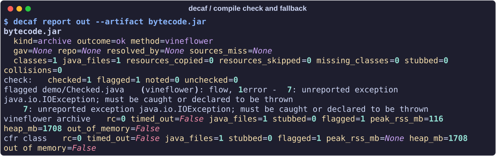

# Compile checks

[README](../README.md) · [Reports](reports.md)

decaf checks each decompiled Java source file with `javac`, without writing
class files. A parse, name, or flow error sends the affected class to the next
decompiler. The first version without those errors goes into the output.



The [demo fixture](development.md#readme-media) throws a checked exception
without declaring it in the bytecode. Both engines produce Java that `javac`
rejects, so the report keeps the diagnostic and marks the artifact partial.

## Results

```bash
decaf report out --artifact bytecode.jar
```

| Result | What it means |
| --- | --- |
| Checked without findings | The file passed this check |
| `flagged` | Parse, name, or flow errors remain after retries; the first engine's file is kept and the artifact is partial |
| `noted` | Diagnostics are recorded without triggering a retry, such as incompatible generic types |
| `unchecked` | The checker could not examine the file; the report gives a reason |

- Each flagged or noted file includes up to 100 `javac` diagnostics in line order.
- Kotlin `.kt` output is unchecked. Maven sources are not checked.
- Passing this per-file check does not establish that the whole project builds
  or that the decompiled code behaves identically to the original.

## Dependencies and Java versions

- The classpath includes the input archive, sibling archives from the same
  WAR, fat JAR, or input folder, and their `WEB-INF/classes` or `BOOT-INF/classes`.
- Missing dependencies usually make a file unchecked. Syntax errors still
  flag it. Supplying dependency jars lets the checker examine more files.
- decaf uses the `javac` belonging to the `java` on `PATH`.
- The JDK must be at least as new as the class files. For newer bytecode,
  decaf prints the Java version needed by the check.

## Bytecode that Java cannot express

Some JVM bytecode has no directly compilable Java equivalent. The checker
limits retries for these cases:

- **Undeclared checked exceptions and return-type-only overloads:** for Kotlin,
  Scala, or Groovy classes, these diagnostics are noted. decaf identifies the
  language from class annotations, the `GroovyObject` interface, or the source
  filename stored in the class file.
- **Other classes with those errors:** retries stop when two consecutive
  engines report the same first error. This can happen with Lombok's
  `@SneakyThrows`. Undeclared `Throwable` or `Exception` does not stop retries,
  because an engine may have dropped the cast in `throw (T) t`.
- **Groovy-generated code:** retries stop after two consecutive engines flag
  a file. groovyc's call-site and meta-class code can produce different errors
  across engines without yielding compilable Java.
- **Detached inner classes:** an engine may write an old bytecode inner class
  as a separate file such as `XStream$1.java`. Errors involving synthetic names
  such as `this$0` are noted. Other errors retry the outer class so another
  engine can nest it correctly. The files are held together during retries
  to avoid duplicate output.

## Cost and controls

- `--no-check` disables the check.
- Each checker JVM runs after its engine JVM, in the same worker and with the
  same heap budget.
- `--timeout` limits each checker JVM as well as each engine invocation.

Recorded examples illustrate the extra runtime; they are not performance
guarantees. In the Jenkins run, Maven supplied sources for 46 of 80 archives.

| Input | With checks | Without checks |
| --- | --- | --- |
| `jenkins.war`, Maven enabled | 7 min | 5 min |
| `jenkins.war`, all 80 archives decompiled with `--no-maven` | 23 min | 7 min |
| One library jar | 24 s | 12 s |
