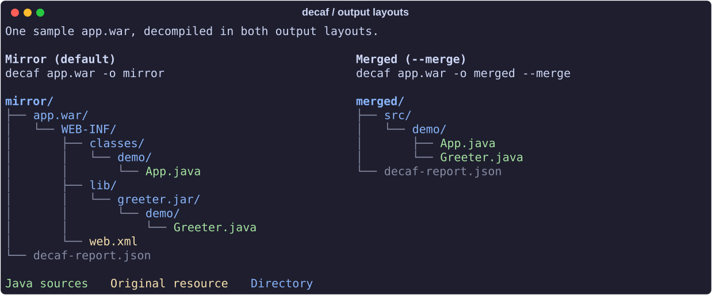

# Output layouts

[README](../README.md) · [Usage](usage.md)



## Mirror

```bash
decaf ./in -o out
```

- Output follows the input tree, with one directory per archive. For example,
  `in/libs/app.war` becomes `out/libs/app.war/`, including directories for
  nested jars such as `WEB-INF/lib/dep.jar/`.
- `.class` files are replaced with `.java` or `.kt` sources.
- Non-class resources are copied byte-for-byte, even when Maven supplies
  the sources or every engine fails.
- Archives beyond `--max-depth` remain archive files.
- `--no-resource` keeps the layout but writes sources only.

Some inputs need special handling:

- Corrupt archives are reported but not copied; damaged entries are skipped.
- Stray `.java` or `.kt` files inside a binary jar are dropped in favor of
  decompiler output.

## Merged

```bash
decaf app.war -o out --merge
```

- Sources from all artifacts go into `out/src/`, arranged by package.
- Container prefixes such as `WEB-INF/classes/` are removed.
- A class folder above its package root loses that part too:
  `target/classes/p/A.class` gives `out/src/p/A.java`.
- Identical duplicate classes are deduplicated.
- When two files for one output path differ, a published source wins over a
  decompiled file. A published source comes from a Maven sources jar or from
  a sources jar in the input. A file from `META-INF/versions/N/` (a variant
  of a multi-release jar) has no such priority: for this rule it counts as a
  decompiled file.
- Between two files of one origin, the first file in input path order wins.
- The report records each collision.
- Resources are skipped and counted in the report.

See [reports](reports.md) to check collisions and other incomplete results.
