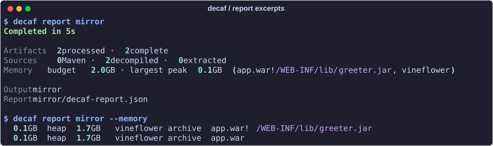

# Reports and exit codes

[README](../README.md)

Every run writes `decaf-report.json` in its output directory. Read it later
without rerunning a decompiler or accessing the network.

```bash
decaf report                         # summary from ./decaf-out
decaf report out --problems          # failed and partial artifacts
decaf report out --artifact '*.jar'  # full details for matching artifacts
decaf report out --network-fallbacks # sources lost to network failures
decaf report out --memory            # ten JVMs with the largest memory peaks
```

- The path can be an output directory or the JSON report itself.
- Repeat `--artifact` to inspect several names or glob patterns.
- Artifact details include engine attempts and [compile-check diagnostics](compile-check.md).



## Complete, partial, and failed

- **Complete:** the artifact finished without missing classes, stubs,
  flagged source files, or a network failure that forced decompilation.
- **Partial:** the artifact produced output but still has missing classes,
  stubbed methods, flagged files, or a network failure that forced decompilation.
  It gets a yellow `!` in terminal output.
- **Failed:** the artifact could not be processed. The report groups failures
  by cause, such as an unreadable archive or an engine timeout.
- Skipped archives and merge collisions are recorded separately. Check
  `totals.partial`, `totals.skipped`, and `totals.collisions` when completeness
  matters.

## Exit codes

| Code | Meaning |
| --- | --- |
| `0` | No artifacts failed; partial results, skips, and collisions can still exist |
| `1` | Some artifacts failed; inspect the report |
| `2` | Usage or environment error |
| `130` | Interrupted by Ctrl-C, SIGTERM, or SIGHUP |

- Interrupted runs write a report with status `interrupted`.
- Errors that stop an active run set status `aborted`.
- Under `nohup`, SIGHUP remains ignored.

## Machine-readable output

```bash
decaf ./libs --format json > report.json
decaf ./libs -o out --format ndjson > events.ndjson
```

| Format | Standard output |
| --- | --- |
| `json` | One final JSON document, byte-identical to `decaf-report.json` |
| `ndjson` | One JSON object per line as the run progresses |

- NDJSON events are `scan`, `artifact` for each completion, `warning`, and
  a final `summary` carrying the run status and report path.
- Narration goes to stderr in both formats. `-q` and `-v` control its verbosity.
- Usage errors leave stdout empty and exit `2`.
- Exit codes are the same in human, JSON, and NDJSON modes.
